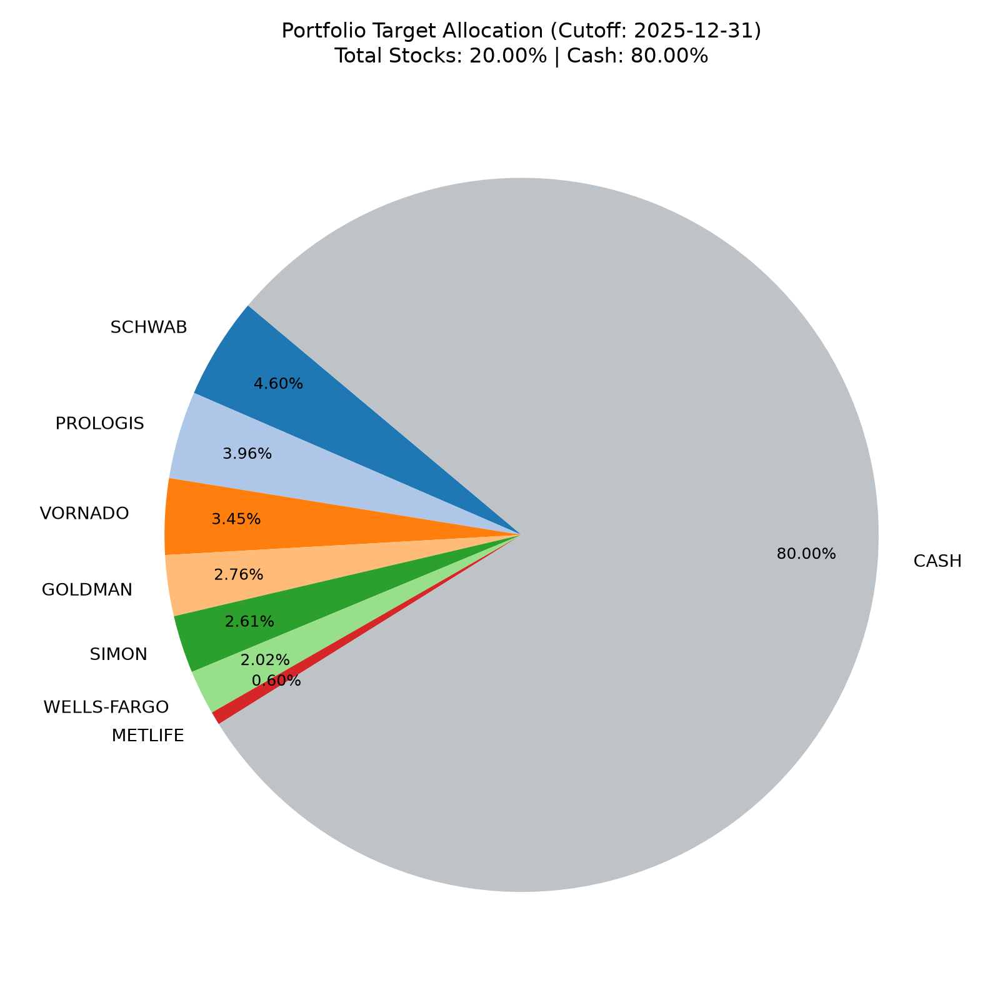
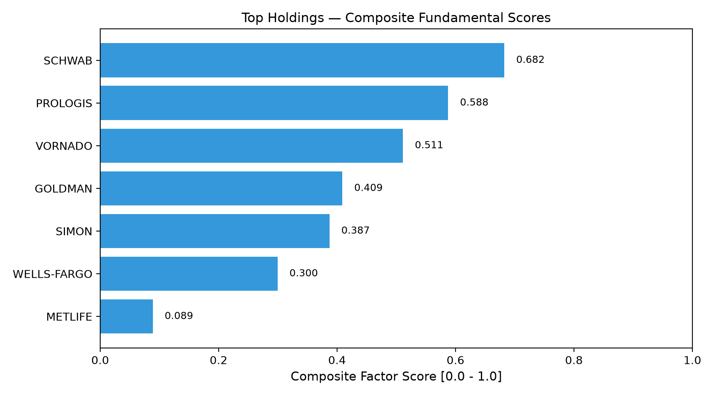

# Portfolio Allocation & Factor Visualization Report

**Cutoff Date:** `2025-12-31`  
**Run Directory:** `artifacts\20261028T162118.392055Z-0671bf04-5bfd-445a-9bc8-f09ce09bf762\ranking`  
**Status:** **ACTIVE PORTFOLIO ALLOCATION**

---

## 1. Cơ cấu phân bổ danh mục đầu tư (Asset Allocation)

Danh mục tuân thủ tuyệt đối quy tắc **Long-only, không leverage**, trần rủi ro **5% mỗi cổ phiếu** và **20% mỗi ngành**. Phần dư thừa do chạm trần được bảo toàn thành **Tiền mặt (Cash)**.

### Bảng phân bổ chi tiết:

| Cổ phiếu | Nhóm ngành | Điểm Composite | Tỷ trọng Mục tiêu | Trạng thái Chạm trần |
|---|:---:|:---:|:---:|:---:|
| **SCHWAB** | Other | `0.6825` | **4.60%** | `sector_20pct` |
| **PROLOGIS** | Other | `0.5876` | **3.96%** | `sector_20pct` |
| **VORNADO** | Other | `0.5114` | **3.45%** | `sector_20pct` |
| **GOLDMAN** | Other | `0.4090` | **2.76%** | `sector_20pct` |
| **SIMON** | Other | `0.3872` | **2.61%** | `sector_20pct` |
| **WELLS-FARGO** | Other | `0.2996` | **2.02%** | `sector_20pct` |
| **METLIFE** | Other | `0.0889` | **0.60%** | `sector_20pct` |
| **TIỀN MẶT (CASH)** | **Bảo toàn vốn** | `—` | **80.00%** | `capital_preservation` |

---

## 2. Sức mạnh điểm số cơ bản của các cổ phiếu (Factor Scoring)

### Chi tiết 4 trục định lượng:

| Cổ phiếu | Chất lượng (Quality) | Tăng trưởng (Growth) | Sức khỏe Nợ (Health) | Tổng hợp (Composite) |
|---|:---:|:---:|:---:|:---:|
| **SCHWAB** | 0.65 | 1.00 | 0.40 | **0.682** |
| **PROLOGIS** | 0.35 | 0.52 | 0.90 | **0.588** |
| **VORNADO** | 0.76 | 0.28 | 0.50 | **0.511** |
| **GOLDMAN** | 0.33 | 0.80 | 0.10 | **0.409** |
| **SIMON** | 0.96 | 0.00 | 0.20 | **0.387** |
| **WELLS-FARGO** | 0.20 | 0.40 | 0.30 | **0.300** |
| **METLIFE** | 0.17 | 0.10 | 0.00 | **0.089** |

---

## 3. Nhận xét định lượng từ Engine

1. **Phân bổ theo chất lượng cơ bản:** Cổ phiếu có điểm số dẫn đầu toàn diện (**SCHWAB** với score `0.682`) được thuật toán phân bổ tỷ trọng lớn nhất (`4.60%`).
2. **Kích hoạt trần an toàn (Safety Caps):** Nhóm ngành chạm ngưỡng giới hạn quy định `20.00%` $\implies$ Thuật toán Water-Filling tự động khóa ngành lại, phần dung lượng chưa phân bổ chuyển thành **80.00% Tiền mặt** để kiểm soát rủi ro tập trung.
